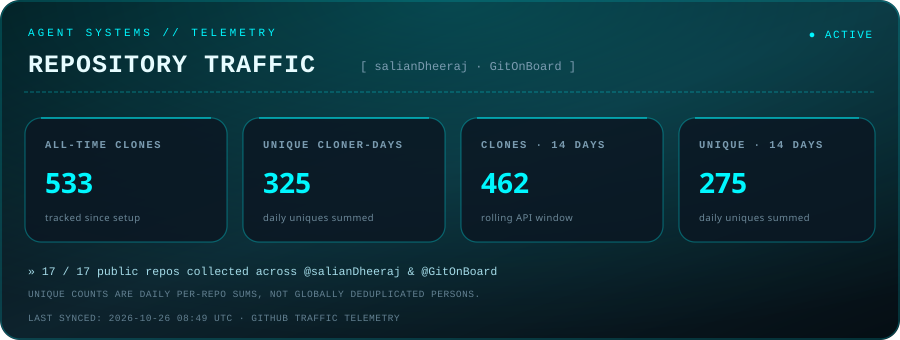

<!-- HEADER -->


<h1 align="center">
  <span style="color:#00F7FF;">SYSTEM // DHEERAJ</span>
</h1>

<p align="center">
  
</p>

<p align="center">
  
</p>

---
<!--  -->
<pre>
<span style="color:#00F7FF;">&gt; help</span>

<span style="color:#7a9bb0;">available_commands:</span>
  &gt; <a href="#whoami"><span style="color:#00F7FF;">whoami</span></a>
  &gt; <a href="#system"><span style="color:#00F7FF;">system</span></a>
  &gt; <a href="#modules"><span style="color:#00F7FF;">modules</span></a>
  &gt; <a href="#metrics"><span style="color:#00F7FF;">metrics</span></a>
  &gt; <a href="#repo_traffic"><span style="color:#00F7FF;">repo_traffic</span></a>
  &gt; <a href="#leetcode"><span style="color:#00F7FF;">leetcode</span></a>
  &gt; <a href="#activity"><span style="color:#00F7FF;">activity</span></a>
  &gt; <a href="#connect"><span style="color:#00F7FF;">connect</span></a>
</pre>

---

<a name="whoami"></a>
## ⌁ &gt; whoami

```bash
dheeraj

ai/ml & backend engineer • agentic-ai specialist
building scalable intelligent systems & agentic architectures
```

<p align="center">
  
</p>

---

<a name="system"></a>
## ⌁ &gt; system

```yaml
status: online
mode: autonomous
signal_strength: █████████░ 90%
primary_objective: build scalable intelligent systems & agentic workflows
secondary_objective: reduce human stupidity via automation
risk_level: acceptable
```

<p align="center">
  
</p>

---

<a name="modules"></a>
## ⌁ &gt; modules

### ⟡ PROGRAMMING LANGUAGES


---

### ⟡ MACHINE LEARNING & AI


---

### ⟡ AGENT SYSTEMS, RAG & LLMs


---

### ⟡ WEB & BACKEND TECHNOLOGIES


---

### ⟡ TOOLS & INFRASTRUCTURE


<p align="center">
  
</p>

---

<a name="metrics"></a>
## ⌁ &gt; metrics

<p align="center">
  
</p>

<p align="center">
  
</p>

<p align="center">
  
</p>

---

<a name="repo_traffic"></a>
## ⌁ &gt; repo_traffic

<!-- REPO-TRAFFIC:START -->
<p align="center">
  
</p>
<p align="center"><sub>All-time totals start when tracking is enabled. Unique counts are daily per-repository sums, not globally deduplicated people.</sub></p>
<!-- REPO-TRAFFIC:END -->

<p align="center">
  
</p>

---

<a name="leetcode"></a>
## ⌁ &gt; leetcode

```yaml
platform: leetcode
status: active
focus: dsa • greedy • system thinking
profile: leetcode.com/u/Dheeraj_Salian
```

<p align="center">
  <a href="https://leetcode.com/u/Dheeraj_Salian/" target="_blank">
    
  </a>
</p>

<p align="center">
  
</p>

---

<a name="activity"></a>
## ⌁ &gt; activity

<p align="center">
  
</p>

<p align="center">
  
</p>

---

<a name="connect"></a>
## ⌁ &gt; connect

<p align="center">
  <a href="https://linkedin.com/in/dheeraj-salian" target="_blank">
    
  </a>
  &nbsp;
  <a href="mailto:dheerajsalian16@gmail.com" target="_blank">
    
  </a>
  &nbsp;
  <a href="https://instagram.com/dhiru_1206" target="_blank">
    
  </a>
  &nbsp;
  <a href="https://reddit.com/user/QuantaraNet" target="_blank">
    
  </a>
</p>

<p align="center">
  
</p>

---

## ⌁ &gt; final_log

```txt
good systems scale.
great systems think.
```

---

<!-- FOOTER -->


